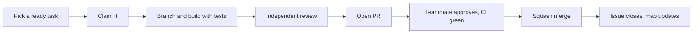

# repo_housekeeping

A starter kit for projects built with AI coding assistants. It contains no application code. It holds the shared setup that makes GitHub Copilot, Claude Code, Cursor and Codex behave the same way in a repo, and a lightweight task system that tells humans and agents what to work on next.

It is adapted from the setup used in [NatureX](https://github.com/melvin1117/naturex), a hackathon project with a small team and several assistants working in parallel.

## Contents
- [What problem it solves](#what-problem-it-solves)
- [What's inside](#whats-inside)
- [Quick start](#quick-start)
- [How the pieces work](#how-the-pieces-work)
  - [Agent rules: AGENTS.md](#agent-rules-agentsmd)
  - [Skills](#skills)
  - [MCP servers](#mcp-servers)
  - [Task list and task map](#task-list-and-task-map)
  - [The per-task workflow](#the-per-task-workflow)
  - [Independent review](#independent-review)
  - [GitHub automation](#github-automation)
- [Scripts reference](#scripts-reference)
- [Customising for your project](#customising-for-your-project)
- [Windows notes](#windows-notes)
- [Maintenance](#maintenance)
- [Troubleshooting](#troubleshooting)
- [Licences](#licences)

## What problem it solves
AI assistants are only as consistent as the instructions they are given. Without shared setup:
- every assistant guesses the project's rules, commands and conventions;
- every teammate wires up tools differently;
- nobody knows which task to pick next, so people overlap or start work that is blocked;
- an agent reviews its own code and misses what it can't see.

This kit gives each of those a file in the repo: one rulebook, one skills library, one list of tools, one task map and one review step.

## What's inside
```text
.
├── AGENTS.md                      Rules every assistant reads first
├── CLAUDE.md                      One line (@AGENTS.md) so Claude Code reads the same rules
├── .agents/
│   ├── skills/                    30 skills: reusable "how to do X" guides
│   ├── references/                7 checklists the skills link to
│   ├── licenses/                  Licence texts of the upstream skill sources
│   └── SOURCES.md                 Where each skill came from, at which commit
├── .claude/
│   ├── skills/                    Symlinks to .agents/skills (plus impeccable's Claude build)
│   └── references                 Symlink to .agents/references
├── .vscode/mcp.json               MCP servers for GitHub Copilot in VS Code
├── .cursor/mcp.json               MCP servers for Cursor
├── .mcp.json                      MCP servers for Claude Code
├── .codex/config.toml             MCP servers for Codex
├── .github/
│   ├── CODEOWNERS                 Who can approve PRs
│   ├── dependabot.yml             Weekly GitHub Actions updates
│   ├── pull_request_template.md   PR form with an independent-review section
│   └── workflows/
│       ├── security.yml           gitleaks, CodeQL, dependency review
│       └── task-map.yml           Keeps the task map in sync with GitHub issues
├── docs/
│   ├── ai-setup.md                Per-tool setup and the review prompt
│   └── ci.md                      Generic CI instructions
├── scripts/
│   ├── sync-skills.sh             Installs skills from pinned upstream commits
│   ├── task_map.py                Builds the task map from todo.md and GitHub issues
│   └── board_status.sh            Moves an issue on a GitHub Project board
├── tasks/
│   ├── todo.md                    The task list (source of the dependency graph)
│   ├── task-map.html              Generated, for people
│   └── task-map.json              Generated, for agents
├── .pre-commit-config.yaml        Whitespace, YAML and large-file hooks
├── .gitattributes                 Line-ending rules
└── .gitignore
```

## Quick start
Do this once for each new project.

1. **Get the files.**
   - Easiest: on GitHub open this repo, Settings, tick **Template repository**, then use **Use this template** to create your project repo.
   - Or copy the folders and files above into your repo.
2. **Fill in `AGENTS.md`.** Replace the Project paragraph and the Commands list with your real project description and commands for install, test, lint and the full check.
3. **Set your identity** in these places:
   - `.github/CODEOWNERS`: your GitHub handle(s).
   - `scripts/task_map.py`: `REPO` (`owner/name`) and `ROLES`.
   - `scripts/board_status.sh`: `OWNER`, `REPO` and `PROJECT` (the number of your GitHub Project board).
   - `tasks/todo.md`: the links to your issues.
4. **Replace the example tasks** in `tasks/todo.md` (T01 to T03) with your own, and create a GitHub issue for each. Keep the [heading format](#task-list-and-task-map).
5. **Enable the dependency graph** so dependency review works: `gh api -X PUT repos/<owner>/<repo>/vulnerability-alerts`.
6. **Add CI** by following [docs/ci.md](./docs/ci.md), then make its checks required on `main`.
7. **Connect your assistant** with [docs/ai-setup.md](./docs/ai-setup.md).
8. **Add a `LICENSE`** (this kit ships without one).

Check it works: open a fresh chat in your assistant and ask "What are the rules for this repo and what task should I pick?". It should repeat your `AGENTS.md` and answer from the task map.

## How the pieces work

### Agent rules: AGENTS.md
`AGENTS.md` is read automatically by Copilot, Cursor and Codex. Claude Code reads `CLAUDE.md`, which contains `@AGENTS.md` to pull in the same text. It holds:
- the **Project** description and the **Commands** to run;
- **non-negotiables**: no secrets in the repo, tests with every change, never push to `main`, small PRs with Conventional Commit titles;
- the **task workflow** (below);
- a table mapping each kind of work to the **skill** to load;
- the **definition of done**.

Keep it short. State rules the assistant can't guess, and link to docs for anything longer.

### Skills
A skill is a folder with a `SKILL.md` that teaches an assistant one way of working. Its `description` tells the assistant when to load it. The kit ships 30, grouped like this:

| Area | Skills |
|---|---|
| Clarify and plan | `interview-me`, `idea-refine`, `spec-driven-development`, `planning-and-task-breakdown`, `context-engineering` |
| Build | `incremental-implementation`, `test-driven-development`, `source-driven-development`, `api-and-interface-design` |
| Database | `supabase`, `supabase-postgres-best-practices` |
| Frontend and UI | `impeccable`, `frontend-ui-engineering`, `web-design-guidelines`, `vercel-react-best-practices` |
| Debug and verify | `debugging-and-error-recovery`, `browser-testing-with-devtools`, `doubt-driven-development` |
| Review and harden | `code-review-and-quality`, `security-and-hardening`, `code-simplification`, `performance-optimization` |
| Ship and operate | `ci-cd-and-automation`, `git-workflow-and-versioning`, `shipping-and-launch`, `deprecation-and-migration`, `observability-and-instrumentation`, `documentation-and-adrs` |
| Process | `constraint-driven-development`, `using-agent-skills` (picks the right skill) |

Where they live:
- `.agents/skills/` is read by Copilot, Cursor and Codex.
- `.claude/skills/` is read by Claude Code. It holds symlinks to the same folders, except `impeccable`, which has a separate Claude build.
- `.agents/references/` holds checklists that skills link to: accessibility, definition of done, observability, orchestration patterns, performance, security and testing.

Skills are vendored from four open-source repos at pinned commits (see [.agents/SOURCES.md](./.agents/SOURCES.md)). Don't edit them in place; update them with `scripts/sync-skills.sh`. Add your own skills as new folders, for example `.agents/skills/write-migration/SKILL.md`:

```markdown
---
name: write-migration
description: Use when adding or changing a database table or column.
---
# Writing a migration
1. Create it with your migration tool.
2. Make it reversible.
3. Test upgrade and downgrade.
```

### MCP servers
MCP servers give an assistant extra tools. The same four are configured for every assistant, each in its own file format:

| Server | What it gives the assistant |
|---|---|
| `github` | Read and manage issues, pull requests and the project board |
| `context7` | Current documentation for libraries and frameworks |
| `playwright` | Drive a browser for end-to-end tests |
| `chrome-devtools` | Inspect, debug and profile a page |

| Tool | Config file |
|---|---|
| GitHub Copilot in VS Code | `.vscode/mcp.json` (signs in to GitHub with OAuth) |
| Cursor | `.cursor/mcp.json` |
| Claude Code | `.mcp.json` |
| Codex | `.codex/config.toml` (loaded only after you trust the project) |

Versions are pinned. Secrets never go in these files: Cursor, Claude Code and Codex read a GitHub token from the `GITHUB_PERSONAL_ACCESS_TOKEN` environment variable. All servers run through `npx`, so Node.js 22+ is required. See [docs/ai-setup.md](./docs/ai-setup.md) for the steps per tool.

### Task list and task map
`tasks/todo.md` lists the tasks. Each one has a heading in an exact format that `scripts/task_map.py` parses:

```markdown
### T02 · Scaffold the application (#2) — Dev · S · Must
- [ ] Create the first runnable skeleton with a test

**Verify:** the test passes locally and in CI · **Deps:** T01
```

| Part | Meaning |
|---|---|
| `T02` | Task id (`T` or `P` plus two digits) |
| `(#2)` | The GitHub issue number |
| `Dev` | Owner role (must match `ROLES` in `task_map.py`, or `All`) |
| `S` | Size: `XS`, `S`, `M` or `L` |
| `Must` | Priority: `Must`, `Should` or `Could` |
| `**Deps:**` | Task ids that must be closed first, or `none` |

Put tasks under `## Week N` headings. The script derives each task's status from the GitHub issues:

| Status | Rule |
|---|---|
| done | the issue is closed |
| picked | the issue is open and has an assignee |
| ready | open, unassigned, and every dependency is closed |
| blocked | at least one dependency is still open |

It writes two files:
- `tasks/task-map.html`: a page for people, with filters by role and status.
- `tasks/task-map.json`: for agents. `suggestions[<role>]` lists the next ready tasks (critical path first), and each task has `waiting_on`, `unlocks`, `critical`, `chain` and `step`.

The **issues are the source of truth for status**. Edit `todo.md` only when scope changes. Never commit the generated files in a PR: the `task-map` workflow owns them.

Run it by hand with `python scripts/task_map.py` (needs the GitHub CLI logged in), or offline with `--issues-json issues.json`. It uses only the Python standard library (3.10+).

### The per-task workflow


1. **Pick** only a ready task, from `tasks/task-map.html` or by asking the assistant. Never start a blocked one.
2. **Claim** it: `scripts/board_status.sh <issue> "In progress"` (sets the board status and assigns you).
3. **Branch and build:** `git checkout -b <type>/<tNN>-<slug>`, implement with tests.
4. **Review** with a separate agent (next section).
5. **Open the PR** from the template with a Conventional Commit title, `Closes #<n>` in the body and a short summary of the review, then `scripts/board_status.sh <issue> "In review"`.
6. **Merge** with squash only after CI is green and a teammate has approved. Merging closes the issue, and the `task-map` workflow refreshes the map.

### Independent review
An assistant that wrote the code is the worst reviewer of it. Before every PR, a **separate agent with fresh context** reviews only `git diff origin/main...HEAD` with the `code-review-and-quality` skill (plus `security-and-hardening` for auth, sessions, user input or text sent to an LLM). It gets only the standard prompt, not the author's explanation. The findings go to the human, who decides what to fix and what to reject with a reason. The PR template has a section for the result. The prompt and how to start a fresh-context reviewer in each tool are in [docs/ai-setup.md](./docs/ai-setup.md). Trivial changes (a typo, a link) can skip it.

### GitHub automation
| Workflow | Runs on | Does |
|---|---|---|
| `security.yml` | PRs, pushes to `main`, manual | gitleaks secret scan always; CodeQL and dependency review only on public repos |
| `task-map.yml` | issue changes, edits to `tasks/todo.md` or `scripts/task_map.py`, daily, manual | regenerates the task map and commits `chore(tasks): sync task map [skip ci]` to `main` |

Other files:
- `dependabot.yml`: weekly PRs that keep GitHub Actions current. Add an ecosystem block when your project has packages.
- `pull_request_template.md`: Summary, Task, Independent review and Test plan sections.
- `CODEOWNERS`: any listed owner can approve a PR.

The `task-map` workflow pushes straight to `main`. If you add branch protection or a ruleset on `main`, give the workflow a bypass or its commits will be rejected.

CI for your own code (lint, tests, build) is not included, because it depends on your stack. [docs/ci.md](./docs/ci.md) has a workflow skeleton, setup snippets for Node, pnpm and Python, a database example, how to make checks required, security practices and notes on deploying.

## Scripts reference
| Script | Needs | Usage |
|---|---|---|
| `scripts/task_map.py` | Python 3.10+, `gh` logged in | `python scripts/task_map.py` or `--issues-json f.json` for offline use |
| `scripts/board_status.sh` | bash, `gh auth login -s project` | `scripts/board_status.sh <issue> "<Todo\|In progress\|In review\|Done>"`; adds the issue to the board if missing and assigns you when set to "In progress" |
| `scripts/sync-skills.sh` | bash, git, network | `scripts/sync-skills.sh` installs or refreshes all skills at the pinned commits and rebuilds the `.claude` mirror |

## Customising for your project
| Change | Where |
|---|---|
| Project description, commands, extra rules | `AGENTS.md` |
| Remove skills you don't need (for example Supabase or Vercel for a non-web project) | delete the folder in `.agents/skills`, its link in `.claude/skills`, its row in `AGENTS.md`, and its entry in `scripts/sync-skills.sh` and `.agents/SOURCES.md` |
| Add a skill | new folder with `SKILL.md` in `.agents/skills`, a symlink in `.claude/skills`, a row in `AGENTS.md` |
| Add or remove an MCP server | all four config files, kept in sync |
| Roles other than `Dev` | `ROLES` in `scripts/task_map.py` and the owner field in `todo.md` headings |
| Dependabot ecosystems | `.github/dependabot.yml` |
| Pre-commit hooks for your language | `.pre-commit-config.yaml` (it already skips `.agents` and `.claude`) |

## Windows notes
- `.claude/skills` uses symlinks. Run `git config --global core.symlinks true` and turn on Developer Mode before cloning, or the links become plain text files and Claude Code can't use the skills. Linux and macOS work as is.
- The shell scripts need bash (Git Bash or WSL).
- `task_map.py` reads and writes files as UTF-8, so it works with the default Windows Python.
- The `.gitattributes` file keeps `*.sh` files on LF line endings so they run under bash.

## Maintenance
- **Update skills:** change the commit in `scripts/sync-skills.sh`, run it, review the diff, update `.agents/SOURCES.md`.
- **Update actions:** merge Dependabot's weekly PRs after the checks pass.
- **MCP versions** are pinned in the four config files; bump them together.
- **Regenerate the task map** locally only to look at it; the workflow commits it.

## Troubleshooting
| Symptom | Cause and fix |
|---|---|
| `dependency-review` fails with "not supported on this repository" | The dependency graph is off. Run `gh api -X PUT repos/<owner>/<repo>/vulnerability-alerts`. |
| `task_map.py`: "No tasks found" | A heading in `todo.md` doesn't match the format, or Python read the file with the wrong encoding (use the current script). |
| `task_map.py`: "Unknown dependencies" | A `**Deps:**` line names a task id that doesn't exist. |
| Every task shows as blocked or the map is empty | The issue numbers in `todo.md` don't match real issues, or `REPO` in `task_map.py` is wrong. |
| `board_status.sh` fails | Not logged in with the `project` scope (`gh auth login -s project`), or `OWNER`, `REPO` or `PROJECT` is wrong. |
| The `task-map` workflow can't push | A ruleset or branch protection blocks the bot; add a bypass for it. |
| Skills show twice in VS Code | VS Code scans both `.agents/skills` and `.claude/skills`. Harmless. |
| Claude Code ignores the skills on Windows | Symlinks weren't enabled when you cloned; see [Windows notes](#windows-notes). |
| An MCP server doesn't start | Check Node.js 22+ and, for the GitHub server in Cursor, Claude Code or Codex, that `GITHUB_PERSONAL_ACCESS_TOKEN` is set. |

## Licences
This repo has no `LICENSE` file yet; add one before sharing the project.

The skills are third-party and keep their own licences (MIT, and Apache-2.0 for `impeccable`). The texts are in [.agents/licenses/](./.agents/licenses/) and the sources are listed in [.agents/SOURCES.md](./.agents/SOURCES.md).
